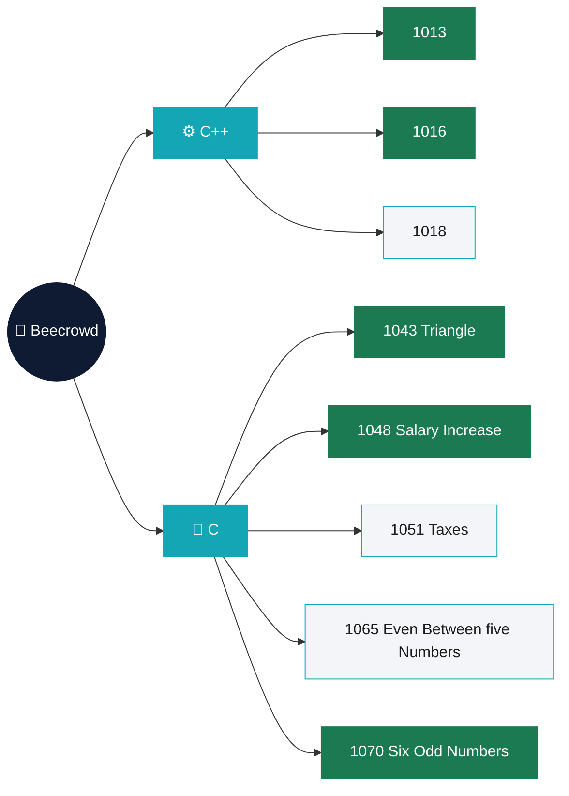

<div align="center">

# 🐝 Beecrowd Problem Solve

**Beecrowd practice by Moinul Islam Rehan, written in C and C++.**
One folder per problem, named after its Beecrowd ID, with the source and the build it was compiled into.


[Map](#-map) · [Problems](#-problems) · [Run a solution](#-run-a-solution) · [Repo notes](#-repo-notes)

</div>

---

## 🗺 Map

Grouped by language. Click any box to open that problem's folder.



<sub>Green: complete program · Light: still in progress</sub>

---

## 📋 Problems

The ID links open the problem on Beecrowd. The source links open the file in this repo.

| ID | Folder | Language | Approach in the code | Source | State |
|:-:|---|:-:|---|---|:-:|
| [1013](https://judge.beecrowd.com/en/problems/view/1013) | `1013` | C++ | Greatest of three numbers with the formula `(a + b + abs(a - b)) / 2`, printed with `eh o maior` | [`1013.cpp`](./1013/1013.cpp) | ✅ |
| [1016](https://judge.beecrowd.com/en/problems/view/1016) | `1016` | C++ | Multiplies the input by 2 and prints it with `minutos` | [`1016.cpp`](./1016/1016.cpp) | ✅ |
| [1018](https://judge.beecrowd.com/en/problems/view/1018) | `1018` | C++ | Started: reads `n`, no logic or output yet | [`1018.cpp`](./1018/1018.cpp) | 🚧 |
| [1043](https://judge.beecrowd.com/en/problems/view/1043) | `1043_Triangle` | C | Valid triangle prints `Perimetro`, otherwise prints the trapezium `Area` | [`1043_Triangle.c`](./1043_Triangle/1043_Triangle.c) | ✅ |
| [1048](https://judge.beecrowd.com/en/problems/view/1048) | `1048_Salary_Increase` | C | Salary bands with 15, 12, 10, 7 and 4 percent raises, prints new salary, raise and percentage | [`1048.c`](./1048_Salary_Increase/1048.c) | ✅ |
| [1051](https://judge.beecrowd.com/en/problems/view/1051) | `1051_Taxes` | C | Current code prints six odd numbers after `X`, the same loop as 1070 | [`1051_Taxes.c`](./1051_Taxes/1051_Taxes.c) | 🚧 |
| [1065](https://judge.beecrowd.com/en/problems/view/1065) | `1065 - Even Between five Numbers` | C | Started: declares an array of five numbers, no logic or output yet | [`Even Between five Numbers.c`](./1065%20-%20Even%20Between%20five%20Numbers/Even%20Between%20five%20Numbers.c) | 🚧 |
| [1070](https://judge.beecrowd.com/en/problems/view/1070) | `1070_Six_Odd_Numbers` | C | Prints six consecutive odd numbers starting from `X`, with separate even and odd branches | [`1070_Six_Odd_Numbers.c`](./1070_Six_Odd_Numbers/1070_Six_Odd_Numbers.c) | ✅ |

> [!NOTE]
> The ✅ mark means the file holds a complete program that reads input and prints an answer. It is not a judge verdict. 🚧 marks a file that was started and still needs work.

<details>
<summary><b>🚧 Open work, in detail</b></summary>

<br>

| ID | What is left |
|:-:|---|
| 1018 | `int n` is missing its semicolon, so the file does not compile yet, and there is no output |
| 1051 | The folder is named Taxes, but the code is the odd numbers loop. The taxes logic is still to be written |
| 1065 | `scanf` reads five values into `&a[5]` and nothing is printed yet |

</details>

<details>
<summary><b>📂 What each folder contains</b></summary>

<br>

| Folder | Source | Object file | Windows build |
|---|:-:|:-:|:-:|
| [`1013`](./1013) | `.cpp` | `.o` | `.exe` |
| [`1016`](./1016) | `.cpp` | `.o` | `.exe` |
| [`1018`](./1018) | `.cpp` | none | none |
| [`1043_Triangle`](./1043_Triangle) | `.c` | `.o` | `.exe` |
| [`1048_Salary_Increase`](./1048_Salary_Increase) | `.c` | `.o` | `.exe` |
| [`1051_Taxes`](./1051_Taxes) | `.c` | `.o` | `.exe` |
| [`1065 - Even Between five Numbers`](./1065%20-%20Even%20Between%20five%20Numbers) | `.c` | `.o` | `.exe` |
| [`1070_Six_Odd_Numbers`](./1070_Six_Odd_Numbers) | `.c` | `.o` | `.exe` |

</details>

---

## ⚡ Run a solution

The committed builds are Windows executables made with MinGW-w64 GCC 8.1.0. To build from source on any machine with GCC:

```bash
# Clone
git clone https://github.com/moinul-rehan/Beecrowd-Problem-Solve.git
cd Beecrowd-Problem-Solve

# C solution
gcc "1048_Salary_Increase/1048.c" -o salary
./salary

# C++ solution
g++ "1013/1013.cpp" -o greatest
./greatest
```

Each program reads from standard input, so type the sample input and press Enter.

---

## 🧾 Repo notes

<details>
<summary><b>Build files in the repo</b></summary>

<br>

The `.o` and `.exe` files next to each source are compiler output from a Windows machine. They are kept as committed. Only the `.c` and `.cpp` files are needed to rebuild a solution.

</details>

<div align="center">

---

Made in Dhaka 🇧🇩 by **Moinul Islam Rehan**

</div>
